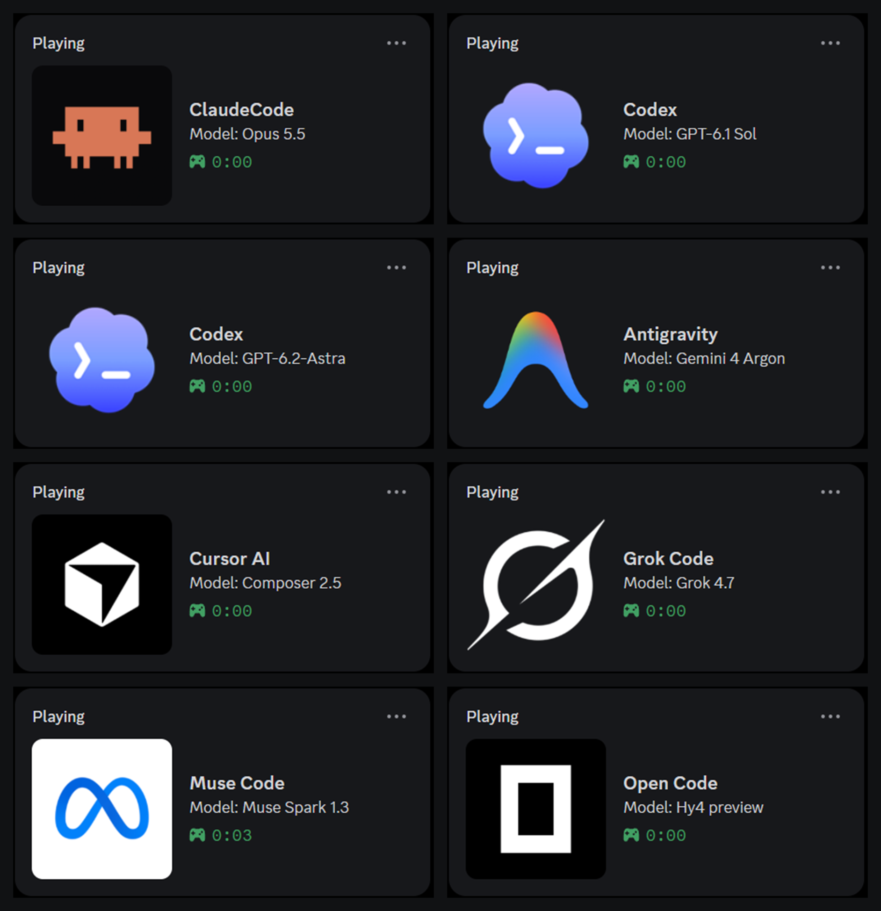
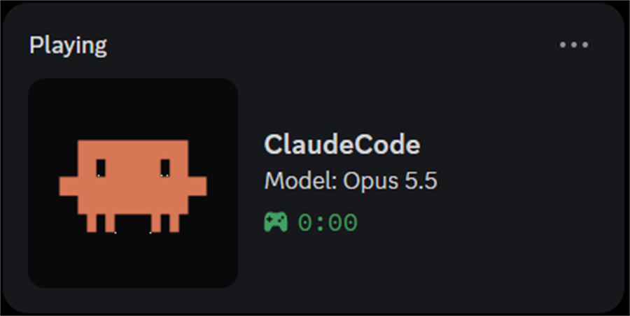
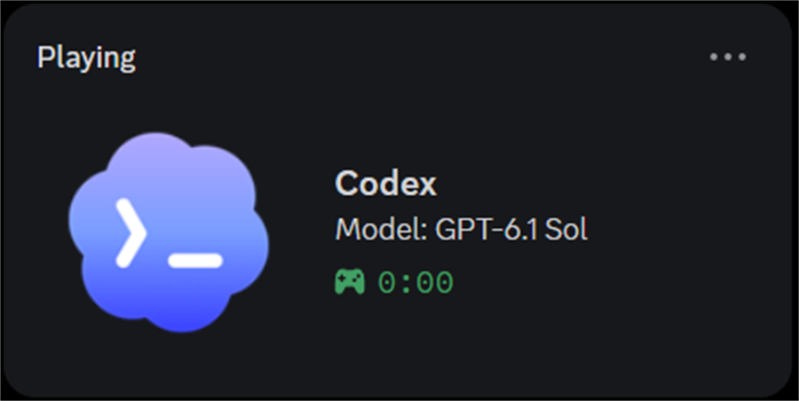
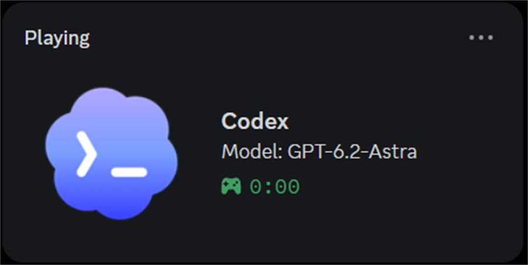
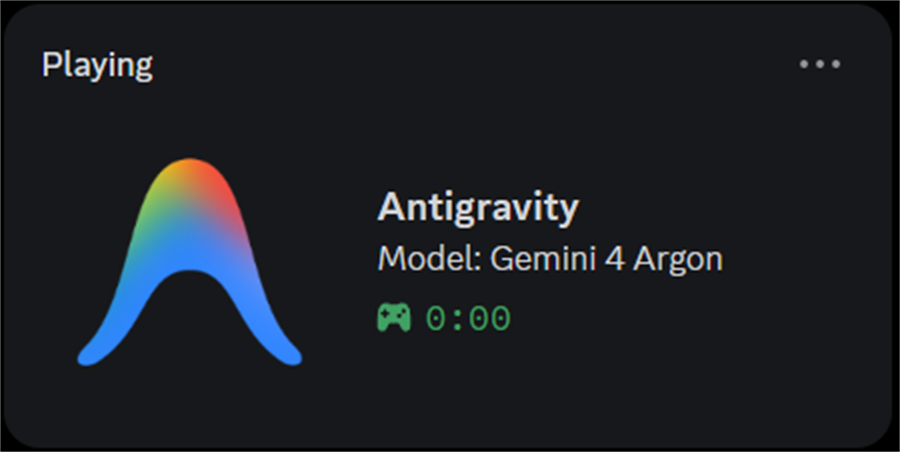
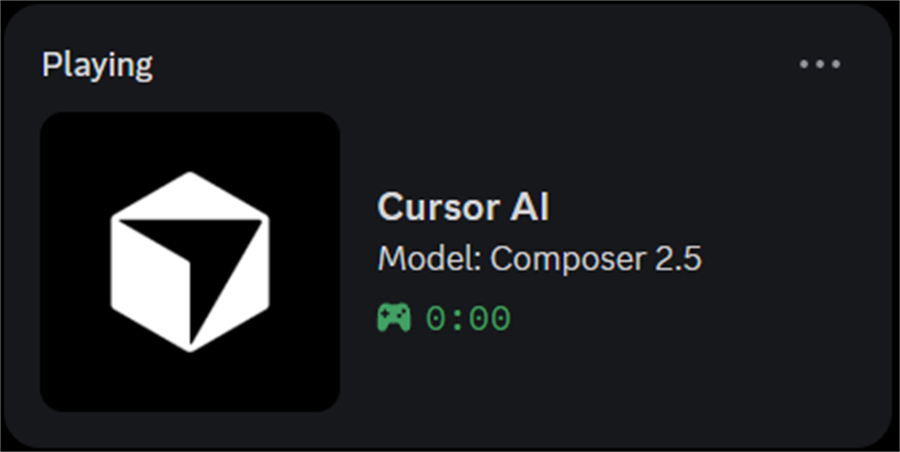
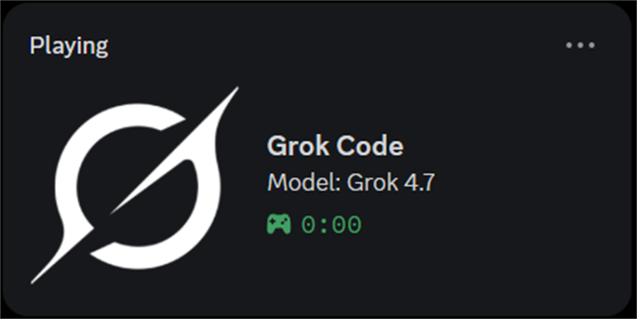
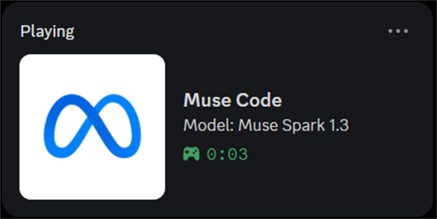
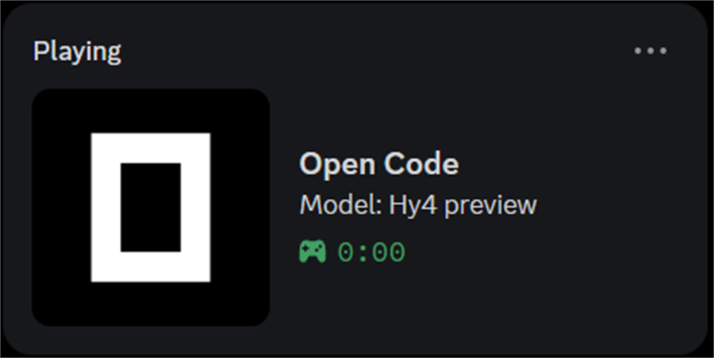

<h1 align="center">Discord Coding Status</h1>

<p align="center">
  Shows the AI coding tool you are using, and its model, in your Discord status.
</p>

<p align="center">
  <a href="https://github.com/u2n4/discord-coding-status/actions/workflows/ci.yml"></a>
  <a href="https://nodejs.org/"></a>
  
  <a href="./LICENSE"></a>
</p>

<p align="center">
  
</p>

A small background program that watches which AI coding tool you are working in and puts it on your
Discord profile, with the model you picked:

```text
Playing Codex
Model: GPT-6.1 Sol
```

That is all Discord ever sees: the tool's name and one model line, written the way the tool itself
writes it. No prompts, files, project names, branches, quotas or timers.

It is not a Discord bot. It talks to the Discord Desktop app on your own computer, so there is no
token, server or account to set up.

## Contents

- [Supported tools](#supported-tools)
- [Requirements](#requirements)
- [Install](#install)
- [How it chooses what to show](#how-it-chooses-what-to-show)
- [Check that it works](#check-that-it-works)
- [Configuration](#configuration)
- [Troubleshooting](#troubleshooting)
- [Update](#update)
- [Uninstall](#uninstall)
- [Privacy](#privacy)
- [Development](#development)
- [Credits and license](#credits-and-license)

## Supported tools

Every model is read from the tool's own files or its own model list, so a model released tomorrow
shows up without updating this project. If the model cannot be proven, Discord shows the tool's name
only; it never guesses.

| Tool | In Discord | Where the model comes from |
| --- | --- | --- |
| Claude Code (CLI) |  | Hook data, else the session transcript |
| Claude Desktop app | same identity as Claude Code | The model button in the window; on the Code tab, the session you used last |
| Codex Desktop app |  | Hook data, else the model you last picked in the composer |
| Codex CLI |  | Hook data, else the `--model` / `-m` flag, else `config.toml` (a `/model` switch counts) |
| Antigravity |  | The picker's selection, named through Antigravity's own model list |
| Antigravity CLI (`agy`) | same identity as Antigravity | The last model line in its `cli.log` |
| Cursor |  | The Agent model pick in Cursor's settings database |
| Grok Code |  | Hook data, else the running session's `summary.json` |
| Muse Code |  | Hook data, else the session the running TUI opened |
| OpenCode |  | Your latest pick in `~/.local/state/opencode/model.json` |
| Pi | tool name only | — |

The screenshots are real Discord captures (Windows 11, November 2026).

## Requirements

| Need | Notes |
| --- | --- |
| Discord **Desktop** app, signed in | The browser version of Discord cannot receive activity. |
| Node.js 20 or newer | Install the **LTS** version from <https://nodejs.org>; it includes `npx`. Node.js 22.13+ is recommended: Cursor's model, and the Antigravity fallback, are read with Node's built-in SQLite. |
| Windows 10/11 | Tested here: every tool above, start-at-login, window-focus switching. |
| macOS | Start-at-login and hooks come from the original project and are not re-tested. Antigravity's model list and Claude Desktop's model button are read on Windows only. |
| Linux | Not supported by `setup`, `uninstall` or start-at-login, and untested. |

In Discord, open **User Settings → Activity Privacy** and turn on sharing your activity, or nobody
(including you) will see the card.

## Install

Open a terminal (Windows: PowerShell or Command Prompt; macOS: Terminal) and run the command below.
If you just installed Node.js, close and reopen the terminal first.

```sh
npx @u2n4/discord-coding-status@latest setup
```

> [!TIP]
> On Windows, if PowerShell answers *running scripts is disabled on this system*, run
> `npx.cmd @u2n4/discord-coding-status@latest setup` instead, or use Command Prompt.

That one command downloads the program from npm and runs `setup`, which:

1. finds the AI tools you have installed;
2. copies a self-contained copy of the program into your user app-data folder;
3. registers it to start when you log in (a Scheduled Task on Windows, a LaunchAgent on macOS) and
   starts it now;
4. adds small lifecycle hooks to the tools that support them (Codex, Claude Code, Grok Code, Muse
   Code, Antigravity), so model changes reach Discord at once.

Then:

- **Codex:** open Codex, type `/hooks`, and trust the six Discord Coding Status hooks. Codex will not
  run them until you do.
- Restart any Codex, Claude Code, Grok Code or Muse Code session that was already open, so it loads
  the new hooks.

Hooks are optional. Every tool is also found from its running process; hooks just make updates
instant. Skip or force one tool's hooks with `--no-<tool>-hooks` or `--<tool>-hooks`, for example
`npx @u2n4/discord-coding-status setup --no-grok-hooks`.

## How it chooses what to show

Discord shows one activity at a time, so when several tools are open:

1. The tool in the window you are looking at wins (Windows). A CLI counts when its terminal is in
   front, even while it waits for you.
2. When a tool has both an app and a CLI (Claude, Codex), the app wins unless the CLI's terminal is in
   front.
3. A tool reporting through hooks outranks one only seen as a running process.
4. If you switch to Discord or a non-AI app, the tool you used last is preferred while it is still
   running.

## Check that it works

Open a supported tool and send it a prompt, then click your avatar in Discord: your profile shows
the tool and its model, for example `Playing Codex` / `Model: GPT-6.1 Sol`.

From the terminal:

```sh
npx @u2n4/discord-coding-status status
npx @u2n4/discord-coding-status hooks status
```

`status` shows the background service and the tools it found. `hooks status` prints, as JSON, which
hooks are installed for each tool.

## Configuration

Most people need none. The file is `~/discord-coding-status/config.json` and starts as `{}`.

Each tool appears in Discord through a Discord application (that is where the name and icon come
from). Built-in applications are included for every tool; to use your own, create one at
<https://discord.com/developers/applications> and put its Application ID here:

```json
{
  "museClientId": "123456789012345678"
}
```

| Key | Default | Effect |
| --- | --- | --- |
| `codexClientId`, `claudeClientId`, `antigravityClientId`, `cursorClientId`, `grokClientId`, `museClientId`, `opencodeClientId`, `piClientId` | built in | The Discord application shown for that tool. |
| `stateFile` | `~/discord-coding-status/states.json` | Where hook sessions are stored. |

Or run `npx @u2n4/discord-coding-status config`: it asks for each value, showing the built-in one. Enter keeps a
value, `-` clears your override.

After editing the file, run `npx @u2n4/discord-coding-status setup` again: it restarts the background program and
keeps your settings.

## Troubleshooting

| Problem | Fix |
| --- | --- |
| PowerShell: *running scripts is disabled on this system* | Write `npx.cmd` instead of `npx` at the start of the command, or use Command Prompt. |
| `npx` is not recognized | Install Node.js LTS from <https://nodejs.org>, then close and reopen the terminal. |
| Nothing on Discord | Use the Discord Desktop app, not the browser, and turn on activity sharing in User Settings → Activity Privacy. |
| The card shows the tool but no model | The model could not be proven yet. Send one prompt in that tool, or pick a model in its picker. |
| Codex updates are late | Run `/hooks` in Codex and trust the Discord Coding Status hooks. |
| A tool never appears | Without hooks, a tool counts only while it is busy or its window is in front; send it a prompt. If you installed the tool after this program, run `npx @u2n4/discord-coding-status setup` again to add its hooks. |
| Anything else | Read the logs (below), then open an issue with the last lines. |

Logs:

| System | Folder |
| --- | --- |
| Windows | `%LOCALAPPDATA%\discord-coding-status\logs\` |
| macOS | `~/Library/Logs/discord-coding-status/` |

<details>
<summary>Terminal-only extras</summary>

These print in your terminal and never reach Discord:

```sh
npx @u2n4/discord-coding-status quota                # Codex plan and limits
npx @u2n4/discord-coding-status quota --tool claude  # Claude subscription limits
npx @u2n4/discord-coding-status quota --tool grok
npx @u2n4/discord-coding-status quota --tool cursor
npx @u2n4/discord-coding-status quota --tool opencode
npx @u2n4/discord-coding-status state                # stored hook sessions
```

`quota` contacts the vendor's own usage endpoint with the login that tool already saved on your
computer. Nothing is sent anywhere else.

</details>

## Update

```sh
npx @u2n4/discord-coding-status@latest setup
```

Your config and sessions are kept. If Codex says its hooks changed, trust them again with `/hooks`.

## Uninstall

Remove the hooks first, while the program they point to still exists:

```sh
npx @u2n4/discord-coding-status hooks uninstall
npx @u2n4/discord-coding-status uninstall --purge
```

`uninstall` stops the background program and removes start-at-login and the copied program.
`--purge` also deletes `~/discord-coding-status/` (config and sessions).
Only the hooks this project added are removed and your own hooks and settings stay. Codex, Claude Code, Muse Code and Antigravity
keep their previous file as a `.bak` copy; Grok Code's hooks live in a file of their own.

## Privacy

- Discord receives the tool's name and the model line, through Discord Desktop on your own computer.
- Prompts, replies, files, folder names, branches, accounts and quotas are never sent to Discord.
- Hook data stays in a local file on your computer. Prompt and reply text is never stored.
- To name Antigravity's models, the program asks Antigravity's own language server on `127.0.0.1`.
  The background program makes no other network requests.
- No telemetry, no server, no Discord bot token.

Report security problems as described in [SECURITY.md](./SECURITY.md).

## Development

```sh
git clone https://github.com/u2n4/discord-coding-status.git
cd discord-coding-status
npm ci
npm run build
node dist/cli.js setup    # install your local build instead of the npm one
npm test                  # build + full suite, no Discord needed
npm run test:integration
npm run test:stress
```

`node scripts/diagnose-presence.js` prints, for each running tool, the line it would put on Discord
(it does not read Claude Desktop's model button, so that app can show without a model there while
Discord shows it).

Releases: bump `version` in `package.json`, merge, then push a tag `v<version>`. The publish workflow
tests the tag and publishes it to npm through npm trusted publishing (no token).

Tests use a fake local Discord connection, so they run anywhere. CI runs Node.js 20 and 22 on Linux,
and Node.js 22 on macOS and Windows.

| Folder | What lives there |
| --- | --- |
| `src/providers/<tool>/` | Each tool: detection, Discord identity, model reader |
| `src/core/` | Tool-neutral detection, hooks and presence logic |
| `src/adapters/` | Operating-system access (processes, startup) |
| `src/commands/` | The CLI commands |
| `src/presence.ts`, `src/daemon.ts` | Turning the active tool into one Discord activity |

To add a tool, see [docs/adding-a-tool-provider.md](./docs/adding-a-tool-provider.md). Pull requests
are welcome; see [CONTRIBUTING.md](./CONTRIBUTING.md).

## Credits and license

Maintained by [u2n4](https://github.com/u2n4). Originally based on
[howznguyen/discord-coding-status](https://github.com/howznguyen/discord-coding-status) by Howz
Nguyen, which this project has since rewritten around the model-only display and more tools.

[MIT](./LICENSE).
